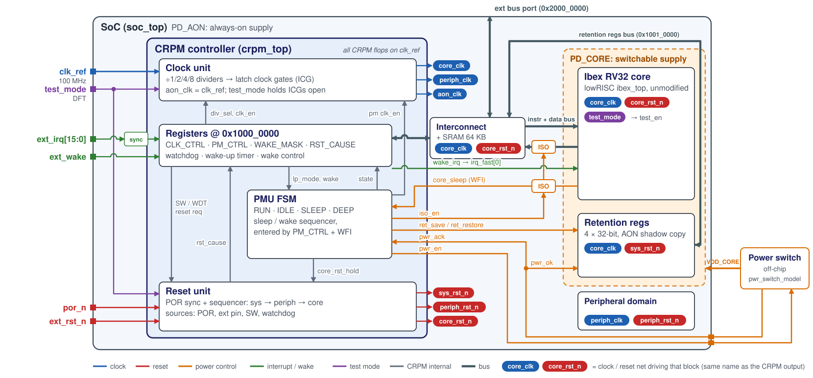

# CRPM Controller for the Ibex RISC-V SoC

A Clock, Reset and Power Management (CRPM) controller for the lowRISC Ibex core, built for the
course **MEL G533: SoC Test and Power-Aware Testing** (BITS Pilani, K.K. Birla Goa Campus).
It continues from Lab 4: the Ibex RTL is reused unchanged from `soc_lab4/ibex` through the `ibex`
symbolic link on the server.

The CRPM generates the core and peripheral clocks, sequences the resets, and switches the core
power domain off and on with isolation and retention. It was then made scan-testable (one
335-flop scan chain, 99.81% stuck-at coverage) and verified through power-down and wake-up.

## Architecture



How to read the diagram:

- **Pins on the left go into the CRPM sub-block that uses them.** `clk_ref` (100 MHz) drives the
  clock unit and every CRPM flop; `por_n` and `ext_rst_n` go to the reset unit; `ext_irq[15:0]`
  (through 2-flop synchronisers) and `ext_wake` go to the wake controller in the register block;
  `test_mode` goes to both the clock gates and the reset bypass, and to Ibex `test_en`.
- **Coloured tags are clock and reset nets.** The clock unit drives `core_clk`, `periph_clk` and
  `aon_clk` (= `clk_ref`), and the reset unit drives `sys_rst_n`, `periph_rst_n` and `core_rst_n`.
  A tag inside a block names the net that clocks or resets it. For example, Ibex and the
  interconnect/SRAM run on `core_clk` / `core_rst_n`, while the retention registers keep
  `sys_rst_n` so a core reset does not clear them.
- **The PMU drives the power-down hardware.** `iso_en` controls the isolation cells (clamp to 0)
  on every PD_CORE output, `ret_save` / `ret_restore` control the retention registers, and
  `pwr_en` drives the off-chip power switch, which supplies `VDD_CORE` and answers with `pwr_ack`.
  Ibex `core_sleep` (WFI) is the sleep request; `wake_irq` returns on `irq_fast[0]`.
- **PD_CORE** (dashed) holds Ibex and the retention registers and can lose power.
  Everything else is in the always-on domain **PD_AON**.

The diagram is generated from the RTL port connections by
[diagram/gen_crpm_diagram.py](diagram/gen_crpm_diagram.py) (`python diagram/gen_crpm_diagram.py`).

### CRPM sub-blocks

| Block | RTL | Function |
|---|---|---|
| Clock unit | `crpm_cells.sv` (`crpm_clk_en_gen`, `crpm_clk_gate`) | Divide-by-1/2/4/8 enable counters drive latch-based clock gates, so derived clocks share `clk_ref` edges. A new ratio is applied only at the end of a period, so there are no glitches |
| Reset unit | `crpm_rst_ctrl.sv`, `crpm_rst_sync` | POR, external, software (keyed) and watchdog sources; releases `sys` → `periph` (+8) → `core` (+8); records `RST_CAUSE` |
| PMU FSM | `crpm_pmu.sv` | RUN / IDLE / SLEEP / DEEP. Sleep: clock off → isolate → save → reset → power off. Wake is the reverse, and each step waits for `pwr_ack` where needed |
| Registers | `crpm_regs.sv` | Register map below, watchdog, wake-up timer, wake mask and pending logic |

### Memory map

| Address | Block |
|---|---|
| `0x0000_0000` | SRAM 64 KB (code + data) |
| `0x1000_0000` | CRPM registers |
| `0x1001_0000` | Retention registers (PD_CORE) |
| `0x2000_0000` | External bus port |
| other | Bus error |

### CRPM registers (base `0x1000_0000`)

| Offset | Name | Access | Description |
|---|---|---|---|
| `0x00` | CLK_CTRL | RW | `[1:0]` core divider, `[5:4]` peripheral divider (÷1/2/4/8), `[8]`/`[9]` clock enables |
| `0x04` | RST_CTRL | WO | Software reset request (key `0xA5A` in `[11:0]`) |
| `0x08` | RST_CAUSE | RW1C | POR / EXT / SW / WDT, sticky |
| `0x0C` | PM_CTRL | RW | Low-power mode for the next WFI: NONE / IDLE / SLEEP / DEEP |
| `0x10` | PM_STATUS | RO | PMU state |
| `0x14` | WAKE_MASK | RW | Wake sources: 16 IRQ lines, wake pin, wake-up timer |
| `0x18`–`0x24` | WDT_CTRL / LOAD / KICK / COUNT | | Watchdog (kick with key `0x5A5A5A5A`) |
| `0x28` | LP_STATS | RO | IDLE and SLEEP entry counters |
| `0x2C` | ID | RO | `"CRPM"` |
| `0x30` | WAKE_PEND | RW1C | Latched wake events |
| `0x34` | WKT | RW | Always-on wake-up timer |
| `0x38`, `0x3C` | SCRATCH0/1 | RW | Reset only by POR (the firmware keeps its stage here) |

### Low-power modes

| Mode | Core clock | Core power | Peripheral clock | On wake-up |
|---|---|---|---|---|
| IDLE | Off | On | On | Core continues after WFI |
| SLEEP | Off | Off (retention) | On | Core reboots, state restored |
| DEEP | Off | Off (retention) | Off | Core reboots, state restored |

### Design for test

In test mode (`test_mode = 1`) every clock gate is held open, so all clocks are `clk_ref`, and every
reset comes straight from `por_n`, bypassing the synchroniser and the sequencer. Genus reports
0 DFT rule violations before synthesis, after mapping and after scan insertion.

## Results

| Run | Result |
|---|---|
| CRPM block test (`crpm_tb`, 12 tests) | 262 checks, 0 errors, 0 clock glitches, no assertion failures |
| SoC test with Ibex (`soc_tb` + firmware) | Firmware PASS, 19/19 testbench checks |
| Genus (gsclib045, slow corner) | 1520 cells, 4990 µm², +3.8 ns slack at 100 MHz |
| Scan insertion | 1 chain, 335 flops, 0 DFT violations |
| Modus ATPG (stuck-at) | 99.81% test coverage (99.61% global), 122 patterns |
| Power (Genus, vectorless, 100 MHz) | 144 µW total, 81% in registers (`syn/rpt/power.rpt`) |
| Scan-shift power estimate | About 1.5× functional at 100 MHz, halved by shifting at the 50 MHz test clock |

## Files

| Folder | Files | Contents |
|---|---|---|
| rtl/ | crpm_pkg.sv, crpm_cells.sv, crpm_rst_ctrl.sv, crpm_pmu.sv, crpm_regs.sv, crpm_top.sv | CRPM controller |
| rtl/ | soc_top.sv, soc_core_pd.sv, soc_ram.sv, soc_ret_regs.sv | SoC: Ibex power domain with isolation, RAM, retention registers |
| tb/ | crpm_tb.sv, crpm_sva.sv | Block-level testbench and assertions |
| tb/ | soc_tb.sv, pwr_switch_model.sv | SoC testbench and power switch model |
| sw/ | crpm_test.S, rvasm.py | Test firmware and RV32I assembler (no RISC-V GCC on the server) |
| syn/ | genus_crpm.tcl, crpm.sdc, modus_atpg.tcl | Synthesis with scan insertion, and ATPG (reports in `syn/rpt`, netlist in `syn/out`) |
| scripts/ | run.csh, crpm_rtl.f, ibex.f, soc_rtl.f | Run script and file lists |
| sim/ | xrun_unit.log, xrun_soc.log, fw.hex, fw.lst | Simulation logs and assembled firmware |
| diagram/ | gen_crpm_diagram.py, crpm_soc.svg, crpm_soc.png | Block diagram above |
| docs/ | Group_7_CRPM_Presentation.pptx, Group_7_CRPM_Report.pdf | Final presentation and report |

## How to run

Location on the server: `~/cadence_chipin_work/soc_crpm_project`

Set up the tools:

```
csh
cd ~/cadence_chipin_work
source cshrc
cd soc_crpm_project
```

Simulation (Xcelium):

```
csh -f scripts/run.csh unit     # CRPM block test
csh -f scripts/run.csh soc      # Ibex SoC test (assembles sw/crpm_test.S first)
csh -f scripts/run.csh all      # both
csh -f scripts/run.csh soc gui  # open SimVision with waveforms
```

The script prints `ALL REQUESTED TESTS PASSED` only if both tests pass and no assertion failed.
Logs: `sim/unit/xrun_unit.log`, `sim/soc/xrun_soc.log`.

Synthesis and ATPG (run from `syn/`):

```
cd syn
genus -batch -files genus_crpm.tcl -log genus_crpm
modus -file modus_atpg.tcl
```

Synthesis uses the gsclib045 library, because the course `typical.lib` has no scan cell models.

## Group 7

Akshit Sharma, Ayushman Muduli, Pulkit Deepak Singla, Soumyadeep Mandal, Tilak Sakalley.
Guided by Prof. Suman Bhowmik.
